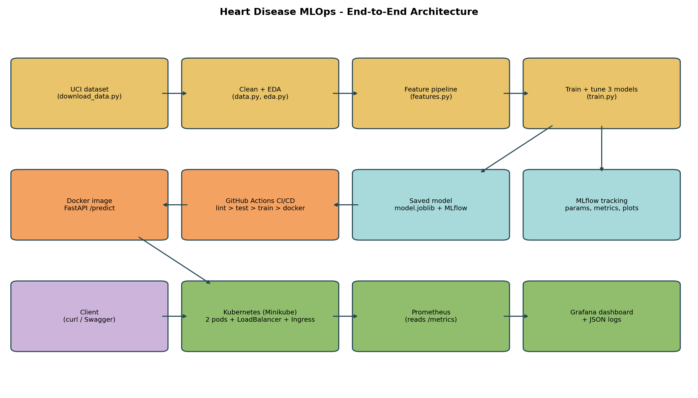

# Heart Disease Risk Prediction - End-to-End MLOps
STUDENT_NAME = "Abhishek Singh"
BITS_ID = "2025AE05961"

Predicts heart-disease presence from 13 clinical values in the UCI
Cleveland dataset and serves the model through a containerised,
monitored API.

- **Course:** AIMLCZG523 MLOps - Assignment 01
- **Student:** Abhishek Singh (2025AE05961)
- **Repository:** https://github.com/abhisheksingh-ml/2025AE05961_MLOps_AIMLCZG523-Assignment-01
- **Demo video:** [https://drive.google.com/file/d/1m59lCgjI2J6erj946fE7vSJM_i4ePiXU/view?usp=drive_link](https://drive.google.com/file/d/1m59lCgjI2J6erj946fE7vSJM_i4ePiXU/view?usp=sharing)



## Repository layout

| Path | What is inside |
|---|---|
| `data/download_data.py` | Dataset download script |
| `data/processed/heart_clean.csv` | Cleaned dataset |
| `src/` | Data cleaning, EDA, features, training, MLflow tracking, evaluation, and prediction |
| `app/main.py` | FastAPI service: `/predict`, `/health`, and `/metrics` |
| `tests/` | Pytest unit tests |
| `.github/workflows/ci-cd.yml` | GitHub Actions workflow |
| `Dockerfile` | API container definition |
| `docker-compose.yml` | API, Prometheus, and Grafana services |
| `k8s/` | Kubernetes deployment, service, and ingress manifests |
| `monitoring/` | Prometheus and Grafana configuration |
| `notebooks/` | Step-by-step project notebook |
| `models/` | Saved model artifacts |
| `reports/` | Evaluation metrics, plots, and final report |
| `screenshots/` | Execution and deployment evidence |

## Set up the environment

Run these commands from the repository root.

### Linux or macOS

```bash
python3 -m venv venv
source venv/bin/activate
python -m pip install -r requirements.txt
```

### Windows PowerShell

```powershell
python -m venv venv
.\venv\Scripts\Activate.ps1
python -m pip install -r requirements.txt
```

## Prepare data and train

```bash
python data/download_data.py
python -m src.eda
python -m src.train
```

## Run code checks and tests

```bash
flake8 src app tests data
python -m pytest
```

## Start the API

```bash
uvicorn app.main:app --host 0.0.0.0 --port 8000
```

Open http://localhost:8000/docs to inspect and test the API.
This command keeps running until you press Ctrl+C.

## View experiment tracking

Run this in another terminal with the virtual environment activated:

```bash
mlflow ui --port 5000
```

Open http://localhost:5000.
Use the same MLflow tracking location configured by the training script.

## Build the Docker image

```bash
docker build -t heart-disease-api:1.0.0 .
```

## Start the container and monitoring services

Stop any locally running API that already uses port 8000, then run:

```bash
docker compose -f docker-compose.yml up --build -d
docker compose -f docker-compose.yml ps
```

To stop the services:

```bash
docker compose -f docker-compose.yml down
```

## Apply Kubernetes manifests

With the intended Kubernetes cluster selected and the model image
available to that cluster:

```bash
kubectl apply -f k8s/
kubectl get deployments,pods,services,ingress -A
```

## Intended use

This project is an academic demonstration. Its predictions and confidence
scores are model estimates, not medical diagnoses.
