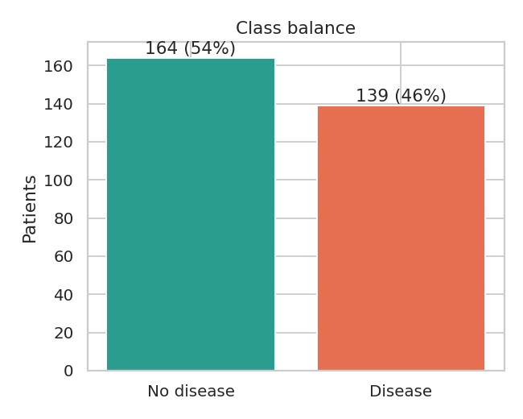
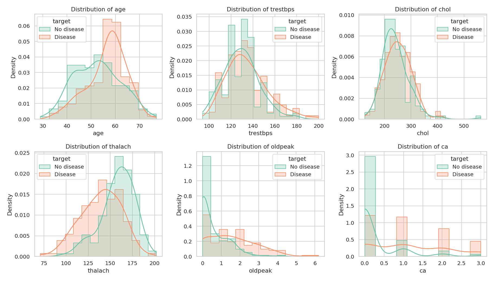
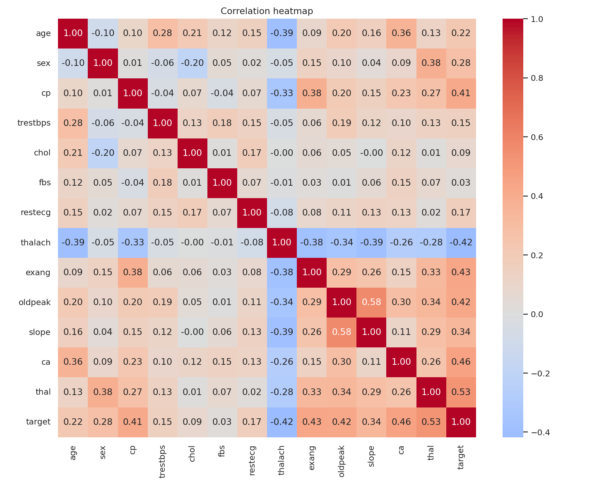
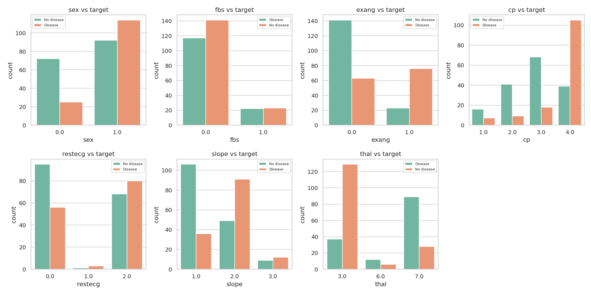
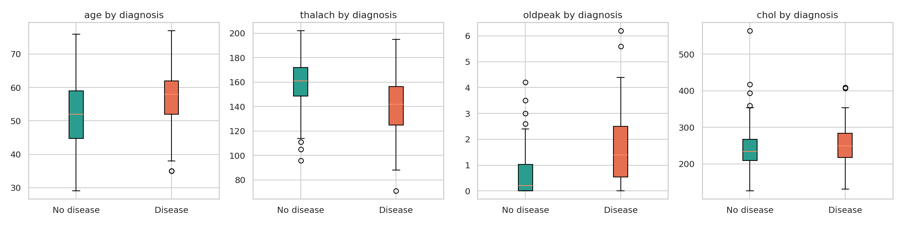
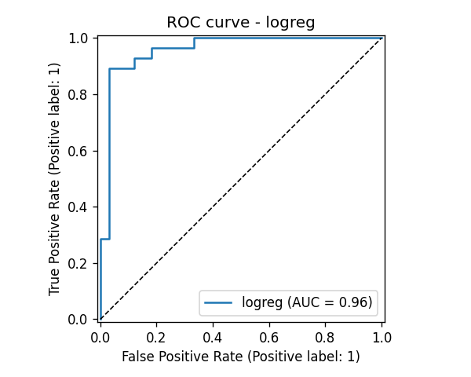
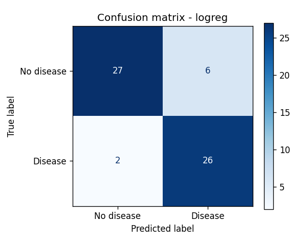
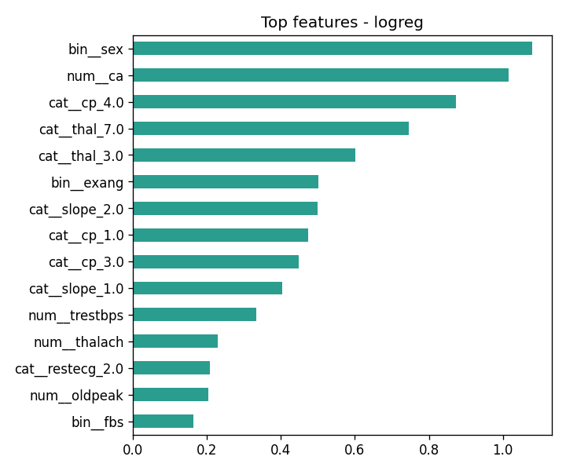
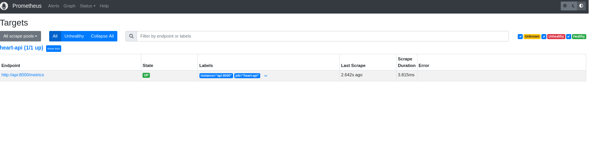
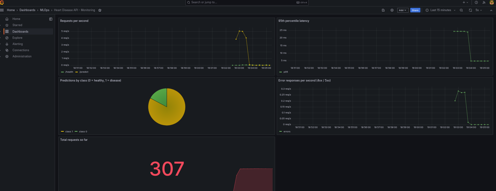

# Heart Disease Risk Prediction - End-to-End MLOps

**Student:** Abhishek Singh (2025AE05961)
**Course:** AIMLCZG523 Machine Learning Operations - Assignment 01
**Repository:** https://github.com/abhisheksingh-ml/2025AE05961_MLOps_AIMLCZG523-Assignment-01
**Demo video:** https://drive.google.com/file/d/1m59lCgjI2J6erj946fE7vSJM_i4ePiXU/view?usp=drive_link
**Environment:** BITS Pilani Prayogshala VM (Python 3.11, Docker, Minikube)

## 1. Objective
Predict whether a patient has heart disease from 13 routine clinical measurements (UCI Heart Disease,
Cleveland dataset), and run the model as a tested, containerised, monitored service on Kubernetes.
The work follows the full MLOps cycle: data, EDA, features, model tuning, MLflow tracking, packaging,
unit tests, CI/CD, Docker, Kubernetes deployment and monitoring.

## 2. Setup and installation
```bash
git clone https://github.com/abhisheksingh-ml/2025AE05961_MLOps_AIMLCZG523-Assignment-01.git
cd 2025AE05961_MLOps_AIMLCZG523-Assignment-01
python3 -m venv venv
source venv/bin/activate
pip install -r requirements.txt
python data/download_data.py
python -m src.eda
python -m src.train
```
*(screenshot 01 not added yet: Clean installation from requirements.txt)*


## 3. Architecture


Flow: UCI data is downloaded and cleaned, a feature pipeline and three tuned models are trained and tracked in
MLflow, the best pipeline is saved, GitHub Actions checks and builds a Docker image, the image runs on Minikube
behind a LoadBalancer and Ingress, and Prometheus and Grafana monitor the live API.

## 4. Data acquisition and EDA

### 4.1 Dataset and cleaning
- Source: UCI Heart Disease, Cleveland file (`data/download_data.py`). 303 patients, 13 features.
- Target: the original diagnosis (0 to 4) is turned into 0 = no disease, 1 = disease.
- Missing values were written as "?" in the raw file. They are in `ca` (4 missing), `thal` (2 missing).
- Duplicates were checked and impossible zeros (cholesterol or blood pressure = 0) are treated as missing.
- Missing values are filled inside the model pipeline (median for numbers, most frequent for categories),
  so training and the live API treat data in exactly the same way.

### 4.2 Observations
**Class balance:** 164 patients without and 139 with heart disease
(54% and 46%). The classes are almost balanced, so no
resampling is needed. I use a stratified split and report ROC-AUC next to accuracy.

**Numeric features:**
- `thalach` (maximum heart rate) is lower for sick patients: median 142 against
  161 for healthy patients.
- `oldpeak` (ST depression) is higher for sick patients: median 1.4 against
  0.2.
- `age` is higher for sick patients: median 58 against 52.
- `chol` and `trestbps` overlap a lot between the two groups, so they are weak signals on their own.

**Categorical features:**
- Chest pain type 4 (asymptomatic): 73% of these patients have heart disease.
- Exercise-induced angina: 77% disease with angina against
  31% without.
- Sex: 55% disease among males against 26% among females.
- Thalassemia 7 (reversible defect): 76% disease; thal 3 (normal):
  22%.

**Strongest correlations with the target (sign shows direction):** `thal` (+0.53), `ca` (+0.46), `exang` (+0.43), `oldpeak` (+0.42), `thalach` (-0.42), `cp` (+0.41).
**Weakest:** `trestbps` (+0.15), `chol` (+0.09), `fbs` (+0.03).
`thal`, `cp` and `slope` are categories stored as numbers, so their correlations are only a rough guide; the
pipeline one-hot encodes them.

**Outliers:** very high cholesterol values (up to 564 mg/dl) and a long tail in
`oldpeak` (up to 6.2). I kept them because they are possible clinical readings; scaling
and the regularised models limit their effect.







## 5. Feature engineering and model development

### 5.1 Features
Three features were added from clinical reasoning: `hr_reserve_pct` (maximum heart rate divided by the age-based
expected maximum, 220 minus age), `high_bp` (resting blood pressure of 140 or more) and `age_chol_index`
(age times cholesterol divided by 1000). Numbers are scaled, categories are one-hot encoded. Everything is one
sklearn pipeline, which is saved together with the model.

### 5.2 Models, tuning and evaluation
Three models were tuned with GridSearchCV (5-fold stratified cross-validation, scoring ROC-AUC) on 80% of the
patients: Logistic Regression, Random Forest and Gradient Boosting. The remaining 20% (61 patients)
was kept untouched for the final test.

| model   |   cv_accuracy |   cv_precision |   cv_recall |   cv_roc_auc |   test_accuracy |   test_recall |   test_roc_auc |
|:--------|--------------:|---------------:|------------:|-------------:|----------------:|--------------:|---------------:|
| logreg  |         0.851 |          0.874 |       0.801 |        0.906 |           0.869 |         0.929 |          0.959 |
| rf      |         0.818 |          0.833 |       0.765 |        0.896 |           0.869 |         0.893 |          0.952 |
| gboost  |         0.814 |          0.816 |       0.783 |        0.878 |           0.902 |         0.929 |          0.958 |

### 5.3 Model selection
**Selected model: logreg** (best settings: `{'clf__C': 0.5, 'clf__class_weight': 'balanced'}`).

It had the highest cross-validated ROC-AUC (0.906), ahead of rf (0.896), gboost (0.878). It also led on
cross-validated accuracy, precision, recall, f1. The dataset is small (303 patients) and the features are mostly clean clinical values, so a simple linear model generalises well, while the tree models have more room to overfit. Logistic regression is also the easiest to explain, because its coefficients show which features push the risk up.

### 5.4 Results on the test patients
- ROC-AUC 0.959, accuracy 0.869, recall 0.929.
- Confusion matrix: 27 true negatives, 6 false positives, 2 false negatives, 26 true positives.
- Only 2 sick patient(s) were missed, which matters for screening, where a missed patient is the costlier
  error. A false alarm only leads to extra tests.
- With only 61 test patients, one wrong prediction moves recall by about 3.6 points,
  so the test scores are indicative, not exact.





## 6. Experiment tracking (MLflow)
Each model is one MLflow run in the experiment `heart-disease-classification`. A run stores the best
parameters, cross-validation and test metrics, the confusion matrix, ROC curve and feature-importance plots,
the full grid-search table and the model with its input signature. The run id of the selected model is
`f72e375fcdf8454a826e0ee13c133e2c`.

*(screenshot 07 not added yet: MLflow runs)*

*(screenshot 08 not added yet: Comparing runs in MLflow)*

*(screenshot 09 not added yet: Artifacts of one run)*


## 7. Packaging and reproducibility
- `models/model.joblib`: the complete pipeline (features, imputing, scaling, encoding, classifier).
- `models/mlflow_model/`: the same model in MLflow format. Both give the same answer for the sample patient.
- `models/metadata.json`: model name, settings, scores, MLflow run id, feature list.
- `requirements.txt` has exact versions; `requirements-serve.txt` is the smaller list for Docker.
- A fixed random seed (42) and stratified splits make the results repeatable.

## 8. Unit tests and CI/CD
19 pytest tests cover data cleaning, features, model training and saving, and the API (valid input, invalid
input returns 422, missing model returns 503, metrics page). flake8 checks the style. GitHub Actions runs four
jobs in order: lint, tests, training with a quality gate (test ROC-AUC of 0.80 or more), and a Docker build with
a smoke test. If one job fails the later jobs are skipped, and logs, reports, MLflow runs and the model are
saved as artifacts.

*(screenshot 11 not added yet: pytest: all tests pass)*

*(screenshot 12 not added yet: GitHub Actions: all jobs green)*

*(screenshot 13 not added yet: GitHub Actions: saved artifacts)*

*(screenshot 15 not added yet: Pipeline stops when a test fails)*


## 9. Docker container
The FastAPI service has `POST /predict` (JSON in, prediction and confidence out), `GET /health` and
`GET /metrics`. Inputs are validated, so invalid values return HTTP 422. The image uses python:3.11-slim, runs
as a non-root user and has a health check. The container reported healthy and answered `/predict`.

*(screenshot 16 not added yet: Docker image build)*

*(screenshot 17 not added yet: Container running and answering /predict)*


## 10. Kubernetes deployment (Minikube)
Manifests in `k8s/`: a Deployment with 2 replicas (readiness and liveness probes on `/health`, CPU and memory
limits), a LoadBalancer Service (port 80 to the container port 8000, NodePort 30080) and an Ingress for the host
`heart-api.local`. Both pods are Running with 0 restarts. The API answers through the NodePort and the Ingress,
and through the LoadBalancer EXTERNAL-IP while `minikube tunnel` is running.

*(screenshot 19 not added yet: kubectl get pods, services and ingress)*

*(screenshot 20 not added yet: LoadBalancer service with EXTERNAL-IP)*

*(screenshot 21 not added yet: Prediction through the cluster)*

*(screenshot 22 not added yet: Request logs from the pods)*


## 11. Monitoring and logging
- **Logging:** the API writes one JSON line per request (method, path, status, time) and one per prediction
  (input and output). They are visible with `docker logs` and `kubectl logs`.
- **Metrics:** `/metrics` exposes request counts, latency and predictions per class.
- **Prometheus and Grafana:** Docker Compose starts both. A load test sent 300 requests, every 15th one
  deliberately invalid and rejected with 422. Prometheus showed the target as up, and the Grafana dashboard
  shows request rate, 95th percentile latency, predictions per class and error responses.

*(screenshot 24 not added yet: JSON request logs)*



*Prometheus target is up*



*Grafana dashboard*


## 12. How to call the API
```bash
curl -X POST http://localhost:8000/predict -H "Content-Type: application/json" -d '{"age": 63, "sex": 1, "cp": 1, "trestbps": 145, "chol": 233, "fbs": 1, "restecg": 2, "thalach": 150, "exang": 0, "oldpeak": 2.3, "slope": 3, "ca": 0, "thal": 6}'
```
On Minikube use the minikube IP with port 30080, or the EXTERNAL-IP of `heart-api-service` (with
`minikube tunnel` running). The response contains `prediction`, `label`, `probability_disease`, `confidence`
and `model_name`. Interactive test page: `/docs`.

## 13. Conclusion
The final pipeline reaches a cross-validated ROC-AUC of 0.906 and a test ROC-AUC of
0.959, with 2 missed disease case(s) among 28 sick test patients. The more
important result for MLOps is that the whole path is reproducible: pinned requirements, a single saved
pipeline, tracked experiments, automated tests, a CI pipeline that stops on errors, a container, a Kubernetes
deployment and live monitoring.

What I learned: keeping preprocessing inside the saved pipeline avoids differences between training and serving;
automated checks catch problems early; and health probes plus metrics make a deployed model observable.

Limitations and next steps: the dataset is small, so scores change with another split; the model has not been
validated on independent patients and is not a medical device. Next steps would be a model registry with staged
promotion, data-drift monitoring, probability calibration, and a cloud cluster instead of Minikube.

## 14. References
- Janosi, A., Steinbrunn, W., Pfisterer, M., Detrano, R. Heart Disease dataset, UCI Machine Learning Repository.
- Documentation of scikit-learn, MLflow, FastAPI, Docker, Kubernetes, Prometheus and Grafana.
