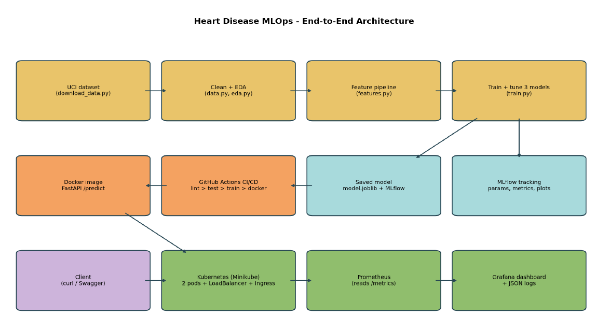
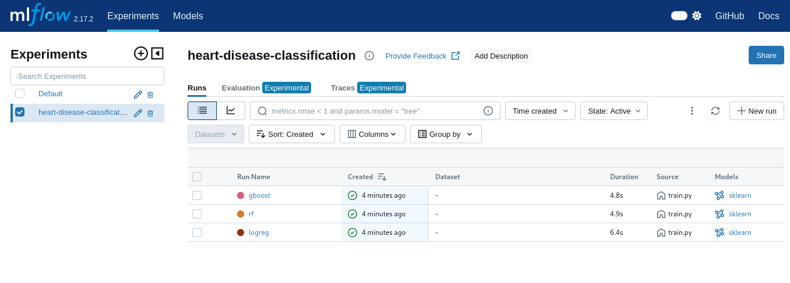
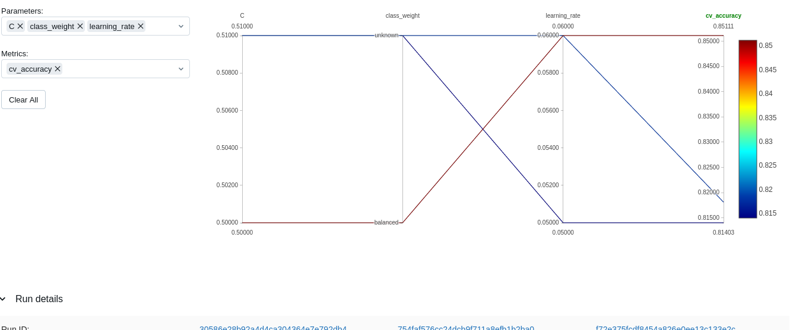
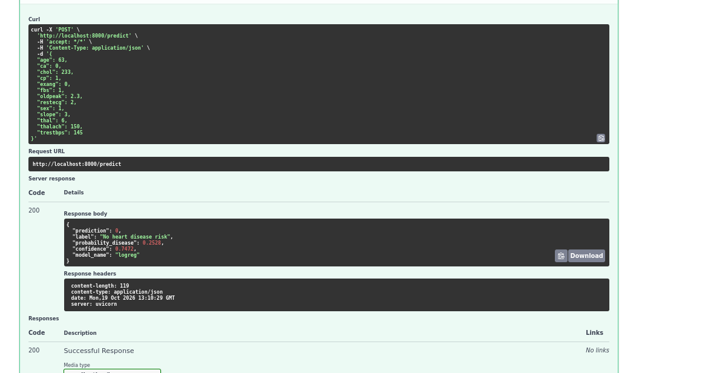

# MLOps Assignment 01: Heart Disease Risk Prediction

**Student:** Abhishek Singh  
**BITS ID:** 2025AE05961  
**Course:** MLOps - AIMLCZG523  

---

## 1. Project Overview

This project implements an end-to-end MLOps pipeline for predicting the presence of heart disease using the UCI Cleveland Heart Disease dataset.

The implementation covers the complete machine learning lifecycle:

- Data acquisition and cleaning
- Exploratory Data Analysis (EDA)
- Feature engineering
- Model training and hyperparameter tuning
- Model evaluation and selection
- MLflow experiment tracking
- Model packaging
- Automated unit testing
- GitHub Actions CI/CD
- Docker containerization
- Kubernetes deployment using Minikube
- Prometheus monitoring
- Grafana visualization

The final application exposes the trained model through a FastAPI inference service.

---

## 2. Setup and Installation

Clone the repository and create the Python environment:

```bash
git clone https://github.com/abhisheksingh-ml/2025AE05961_MLOps_AIMLCZG523-Assignment-01.git

cd 2025AE05961_MLOps_AIMLCZG523-Assignment-01

python3 -m venv venv

source venv/bin/activate

pip install -r requirements.txt

python data/download_data.py

python -m src.eda

python -m src.train
```

---

## 3. Architecture



**Figure 1: End-to-End MLOps Architecture**

The workflow starts with acquisition and cleaning of the UCI Cleveland Heart Disease dataset. Feature engineering and preprocessing are followed by training and tuning three machine learning models.

Experiments are tracked using MLflow and the best pipeline is saved for inference. GitHub Actions provides automated CI/CD validation, while Docker packages the FastAPI application.

The containerized application is deployed on Kubernetes using Minikube. Prometheus collects application metrics and Grafana provides the monitoring dashboard.

---

## 4. Data Acquisition and Exploratory Data Analysis

### 4.1 Dataset

The project uses the UCI Cleveland Heart Disease dataset.

The dataset contains:

- **303 patient records**
- **13 input features**
- Original diagnosis values ranging from 0 to 4

For binary classification, the target was transformed into:

- `0` = No heart disease
- `1` = Heart disease

The original dataset represents missing values using `?`.

Missing observations occur in:

- `ca`: 4 missing values
- `thal`: 2 missing values

Missing values are handled inside the preprocessing pipeline using:

- Median imputation for numerical variables
- Most-frequent imputation for categorical variables

This ensures that training and inference use the same preprocessing logic.

---

### 4.2 Class Distribution

The dataset contains:

- **164 patients without heart disease**
- **139 patients with heart disease**

This corresponds approximately to:

- No disease: **54%**
- Disease: **46%**

The classes are reasonably balanced, therefore no additional resampling technique was required.


**Figure 2: Target Class Distribution**

---

### 4.3 Numerical Feature Analysis

Important observations from numerical features include:

- Maximum heart rate (`thalach`) is generally lower among patients with heart disease.
- ST depression (`oldpeak`) is generally higher among patients with heart disease.
- Age is generally higher among patients with heart disease.
- Cholesterol (`chol`) and resting blood pressure (`trestbps`) show considerable overlap between the two groups.


**Figure 3: Numerical Feature Distributions**

---

### 4.4 Correlation Analysis

Important correlations with the target include:

- `thal`: +0.53
- `ca`: +0.46
- `exang`: +0.43
- `oldpeak`: +0.42
- `thalach`: -0.42
- `cp`: +0.41

Relatively weak correlations include:

- `trestbps`: +0.15
- `chol`: +0.09
- `fbs`: +0.03

Some features such as `thal`, `cp`, and `slope` are categorical variables represented numerically, so correlation values for these variables should be interpreted carefully.


**Figure 4: Feature Correlation Heatmap**

---

### 4.5 Categorical Features

Some notable patterns identified during EDA were:

- Chest pain type 4 showed a high proportion of heart-disease cases.
- Exercise-induced angina was strongly associated with the positive target class.
- Thalassemia category 7 showed a substantially higher disease proportion than category 3.


**Figure 5: Categorical Features Against Target**

---

### 4.6 Outlier Analysis

High cholesterol observations and a long tail in `oldpeak` were observed.

These observations were retained because they represent possible clinical measurements. Scaling and regularized models were used to reduce sensitivity to extreme values.


**Figure 6: Numerical Feature Box Plots**

---

## 5. Feature Engineering and Model Development

### 5.1 Feature Engineering

Three additional features were created:

**Heart Rate Reserve Percentage**

Maximum heart rate relative to the age-based expected maximum heart rate.

**High Blood Pressure Indicator**

A binary variable indicating whether resting blood pressure is at least 140.

**Age-Cholesterol Index**

An engineered interaction between age and cholesterol.

The preprocessing pipeline also performs:

- Missing-value imputation
- Numerical scaling
- Categorical one-hot encoding

The preprocessing transformations and classifier are maintained together in a single Scikit-learn pipeline.

---

## 6. Model Training and Evaluation

Three machine learning algorithms were evaluated:

1. Logistic Regression
2. Random Forest
3. Gradient Boosting

Hyperparameters were tuned using `GridSearchCV` with:

- 5-fold stratified cross-validation
- ROC-AUC as the main optimization metric

The dataset was divided into:

- **80% training data**
- **20% final test data**

The test set contained **61 patients**.

### 6.1 Model Comparison

| Model | CV Accuracy | CV Precision | CV Recall | CV ROC-AUC | Test Accuracy | Test Recall | Test ROC-AUC |
|---|---:|---:|---:|---:|---:|---:|---:|
| Logistic Regression | 0.851 | 0.874 | 0.801 | **0.906** | 0.869 | 0.929 | **0.959** |
| Random Forest | 0.818 | 0.833 | 0.765 | 0.896 | 0.869 | 0.893 | 0.952 |
| Gradient Boosting | 0.814 | 0.816 | 0.783 | 0.878 | 0.902 | 0.929 | 0.958 |

---

### 6.2 Final Model Selection

**Selected model: Logistic Regression**

Best parameters:

```text
C = 0.5
class_weight = balanced
```

Logistic Regression was selected because it achieved the highest cross-validation ROC-AUC:

```text
Logistic Regression : 0.906
Random Forest       : 0.896
Gradient Boosting   : 0.878
```

The dataset contains only 303 patients, and Logistic Regression provided strong generalization while remaining relatively straightforward to interpret.

---

### 6.3 Final Test Results

The selected Logistic Regression model achieved:

- **ROC-AUC:** 0.959
- **Accuracy:** 0.869
- **Recall:** 0.929

The confusion matrix contained:

- True Negatives: 27
- False Positives: 6
- False Negatives: 2
- True Positives: 26

Only two positive patients were classified as negative in the final test set.


**Figure 7: Logistic Regression ROC Curve**


**Figure 8: Logistic Regression Confusion Matrix**


**Figure 9: Logistic Regression Feature Importance**

---

## 7. MLflow Experiment Tracking

MLflow was used for experiment tracking.

The experiment is named:

```text
heart-disease-classification
```

Each candidate model is represented by an MLflow run.

Tracked information includes:

- Hyperparameters
- Cross-validation metrics
- Test metrics
- Confusion matrix
- ROC curve
- Feature importance
- Grid-search results
- Model artifacts
- Model input signature



**Figure 10: MLflow Experiment Runs**



**Figure 11: MLflow Run Details**

The selected model run ID was:

```text
f72e375fcdf8454a826e0ee13c133e2c
```

---

## 8. Model Packaging and Reproducibility

The trained model is saved as:

```text
models/model.joblib
```

This artifact contains the complete pipeline including:

- Feature engineering
- Missing value handling
- Feature scaling
- Categorical encoding
- Classifier

The MLflow version of the model is stored under:

```text
models/mlflow_model/
```

Model metadata is stored in:

```text
models/metadata.json
```

The metadata includes model information, settings, performance results, MLflow run ID and feature information.

The project uses a fixed random seed of:

```text
42
```

to improve reproducibility.

---

## 9. Automated Testing

The project contains automated Pytest tests covering:

- Data cleaning
- Feature engineering
- Model training
- Model saving
- FastAPI endpoints
- Input validation
- Missing-model handling
- Metrics endpoint

The test suite contains **19 tests**.

The completed test execution produced:

```text
19 passed
```

Flake8 is also used for Python code-quality checks.

---

## 10. CI/CD Using GitHub Actions

GitHub Actions provides the CI/CD workflow.

The pipeline contains four main jobs:

1. **Lint**
2. **Unit Tests**
3. **Model Training and Quality Gate**
4. **Docker Build and Smoke Test**

The model-training stage includes a quality gate requiring:

```text
Test ROC-AUC >= 0.80
```

If an earlier stage fails, dependent later stages do not continue.

Pipeline outputs such as reports, MLflow runs and model artifacts can be retained as workflow artifacts.

This CI/CD workflow provides automated validation of the complete machine learning project before deployment.

---

## 11. FastAPI Model Service

The trained model is exposed through FastAPI.

The application provides the following endpoints:

```text
POST /predict
GET /health
GET /metrics
```

### `/predict`

Accepts patient clinical measurements and returns the model prediction and prediction confidence.

### `/health`

Provides an application health check.

### `/metrics`

Exposes application metrics for Prometheus.

Input validation is implemented so invalid inputs return HTTP status:

```text
422
```



**Figure 12: FastAPI Service Interface**

---

## 12. Docker Containerization

The FastAPI model service is packaged as a Docker image.

The implementation uses:

```text
python:3.11-slim
```

The container includes:

- FastAPI application
- Trained machine learning model
- Required serving dependencies
- Health check
- Non-root application execution

The container successfully responded to:

```text
GET /health
POST /predict
```

---

## 13. Kubernetes Deployment

The Dockerized application was deployed to Kubernetes using Minikube.

The Kubernetes configurations are maintained in:

```text
k8s/
```

The deployment consists of:

### Deployment

- 2 application replicas
- Readiness probe using `/health`
- Liveness probe using `/health`
- CPU and memory limits

### Service

A LoadBalancer service exposes the API.

```text
Service port: 80
Container port: 8000
NodePort: 30080
```

### Ingress

The application is also configured with an Ingress using:

```text
heart-api.local
```

During validation, both API pods were running successfully with zero restarts.

The deployed API successfully responded through the Kubernetes service.

---

## 14. Monitoring and Logging

### 14.1 Application Logging

The FastAPI application generates structured request and prediction logs.

Request logging includes information such as:

- HTTP method
- Request path
- Response status
- Processing time

Prediction activity is also logged.

Container logs can be inspected using Docker or Kubernetes logging commands.

---

### 14.2 Prometheus Metrics

The FastAPI `/metrics` endpoint exposes application metrics.

The monitoring implementation captures:

- API request counts
- Request latency
- Prediction counts by class

Prometheus collects these metrics from the running application.


**Figure 13: Prometheus Target Successfully Up**

---

### 14.3 Load Testing

A monitoring load test sent:

```text
300 requests
```

Every 15th request was intentionally invalid.

The resulting execution contained:

- **280 successful requests**
- **20 intentionally invalid requests returning 422**

This generated traffic for validating monitoring behaviour.

---

### 14.4 Grafana Dashboard

Grafana visualizes the metrics collected by Prometheus.

The dashboard includes monitoring for:

- Request rate
- 95th percentile latency
- Predictions by class
- Error responses
- Total requests


**Figure 14: Heart Disease API Grafana Monitoring Dashboard**

---

## 15. API Usage Example

The prediction API can be called using:

```bash
curl -X POST http://localhost:8000/predict \
-H "Content-Type: application/json" \
-d '{
  "age": 63,
  "sex": 1,
  "cp": 1,
  "trestbps": 145,
  "chol": 233,
  "fbs": 1,
  "restecg": 2,
  "thalach": 150,
  "exang": 0,
  "oldpeak": 2.3,
  "slope": 3,
  "ca": 0,
  "thal": 6
}'
```

---

## 16. Repository Structure

```text
2025AE05961_MLOps_AIMLCZG523-Assignment-01/
|
|-- .github/
|   `-- workflows/
|
|-- app/
|
|-- data/
|   `-- download_data.py
|
|-- k8s/
|
|-- models/
|
|-- monitoring/
|
|-- reports/
|   |-- figures/
|   `-- runs/
|
|-- screenshots/
|
|-- scripts/
|
|-- src/
|
|-- tests/
|
|-- Dockerfile
|-- docker-compose.yml
|-- requirements.txt
|-- requirements-serve.txt
|-- setup.cfg
|-- README.md
`-- REPORT.md
```

---

## 17. Final Results Summary

The project successfully demonstrates an end-to-end MLOps workflow for heart-disease classification.

### Machine Learning

- Dataset: **303 patients**
- Models evaluated: **3**
- Selected model: **Logistic Regression**
- Cross-validation ROC-AUC: **0.906**
- Test ROC-AUC: **0.959**
- Test Accuracy: **0.869**
- Test Recall: **0.929**

### Software Quality

- Automated tests: **19**
- Test result: **19 passed**
- Code-quality validation using Flake8
- Reproducible preprocessing and modeling pipeline

### MLOps

The implementation demonstrates:

- MLflow experiment tracking
- Model artifact
